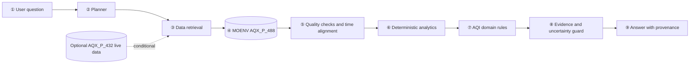

# Taiwan Air Quality Evidence Agent

Living design document for the Proposal and implementation phases. Decisions marked **planned** describe the proposed implementation and should be validated during development. The project is scoped to a Taiwan AQI question-answering evaluation; it does not claim a new general-purpose agent architecture.

## 1. Problem and research question

Users need to interpret air-quality observations by place and time, understand which measurements support the interpretation, and see when evidence is incomplete. The project asks:

> For location- and time-specific questions about Taiwan's AQI, can an agent that retrieves MOENV records, runs deterministic analyses, and grounds its explanation in the source records answer more accurately and traceably than an LLM-only response?

## 2. Scope

### In scope for the proposal prototype

- Offline analysis of MOENV AQX_P_488 historical hourly CSV files.
- Trend summaries, pollutant/AQI context, and station comparisons.
- A deterministic data and analysis layer with an LLM limited to query interpretation and response wording.
- Explicit handling of missing, duplicated, stale, or conflicting records.
- Comparison against an LLM-only response and deterministic tool output.

### Outside the required MVP

- Individual exposure estimation, clinical advice, or causal pollution-source attribution.
- Low-cost IoT sensor calibration or fusion. AQX_P_432 live data can be a later demo extension if access is confirmed.
- Learned forecasting or an open-ended multi-agent topology. Add these only if the team can justify and evaluate them with the available data.

## 3. Data inventory and current audit

### Primary source

- Taiwan Ministry of Environment historical AQI dataset **AQX_P_488**: <https://data.moenv.gov.tw/dataset/detail/aqx_p_488>
- Data fields include station/county, AQI/status, pollutant concentrations, wind, `DataCreationDate`, coordinates, and `SiteId`.
- Current download window: **2026-01-01 00:00 to 2026-10-29 16:00**. This does not constitute a complete year.
- Current local files: 10 monthly/current CSV archives, 970,296 raw rows and 88 distinct station IDs across the period.
- Cleanup produced **606,137 unique station-time observations**. It merged localized duplicate rows, normalized missing sentinels to empty cells, recovered four absent `SiteId` values only where county plus exact coordinates uniquely mapped to one known ID, and excluded 13 conflicting station-time keys (26 source variants).
- Detailed file-level counts and MD5 checksums: `data/processed/cleaning_report.md`. The excluded variants and disagreement fields: `data/processed/aqi_2026_conflicts.csv`.
- Cleaning implementation: `scripts/clean_aqi_data.py`. Raw and generated CSVs are local artifacts excluded from Git because of their size; the source archives can be downloaded again from MOENV and processed with the checked-in script.

The source field `DataCreationDate` is retained as the source-provided timestamp. Whether it should be described as observation time or publication time requires confirmation from the MOENV documentation before making temporal semantics more specific. The raw archives contain both Chinese and English labels, so joins use station ID and timestamp rather than names.

### Optional source

- MOENV current AQI dataset **AQX_P_432**: <https://data.moenv.gov.tw/dataset/detail/aqx_p_432>
- MOENV/Civil IoT sensing overview: <https://env.moenv.gov.tw/en/Issue/Index/53b6ae55-bb69-449e-953e-01c2330ca3b8>
- Any integration depends on confirming API access, time semantics, station mapping, historical retention, sensor class, units, and quality metadata. It is not required for the evaluation to run.

## 4. Requirements

### Functional

- Accept a supported station/location, time window, pollutant, and analysis request.
- Retrieve records from the local AQX_P_488 extract and keep source-file and row-level provenance.
- Validate timestamps, units, missingness, duplicate keys, conflicts, and time coverage.
- Produce reproducible trend, pollutant-context, and station-comparison results.
- Show the station ID/name, source time window, values, source, and known limitations.
- Ask for clarification or return a data-gap/unsupported response when needed.
- Avoid causal source claims and individualized medical advice.

### Non-functional

- Reproducible data preparation and evaluation using versioned code and documented source checksums.
- Numeric values in the response must come from deterministic tools.
- Source data remain immutable; cleanup outputs and conflicts are separate artifacts.
- Missing and conflicting records must remain visible in logs or quality summaries.

## 5. Architecture



## 6. Components

| Module | Responsibility | Input | Output |
|---|---|---|---|
| ① User interaction | Receive question and display answer | Natural-language question | Query text and answer view |
| ② Planner | Extract intent, station/location, period, pollutant; request clarification if needed | Query | Structured query plan |
| ③ Retrieval | Select station IDs and read relevant CSV records | Query plan | Raw records and source metadata |
| ④ MOENV dataset | Provide hourly AQI/pollutant observations | Downloaded archives | Source observations |
| ⑤ Quality/time alignment | Parse Taiwan time, apply missing-value rules, check coverage/duplicates/conflicts | Raw records | Valid records and quality flags |
| ⑥ Analytics | Calculate trend, differences, and station comparisons | Valid observations | Numeric findings and baseline results |
| ⑦ Domain rules | Interpret AQI maximum sub-index and pollutant-specific time windows | Findings and source fields | Qualified domain interpretation |
| ⑧ Evidence guard | Match claims to station/time/value records and assess whether evidence is adequate | Interpretation and records | Supported or qualified claims |
| ⑨ Response layer | Explain results in concise language with provenance and limits | Verified claims | Final response |

## 7. Data handling policy

- Preserve original monthly files unchanged and retain original filenames/checksums.
- Normalize source sentinels (`-`, `--`, `NA`) to empty values in the derived CSV.
- Use `(SiteId, DataCreationDate)` as the observation key. Never join on station name alone.
- Collapse localized duplicate rows only if all non-missing numeric fields agree; fill empty fields from another copy when safe.
- Exclude every variant of a key if two non-missing numeric values conflict. Log the differing fields and source rows.
- Recover a missing `SiteId` only when the county and exact coordinates match exactly one known station ID. Otherwise retain the source row in the conflict log.
- Preserve source time and units. Confirm the meaning of `DataCreationDate` before changing the `observed_at` label.
- Do not infer personal exposure from a fixed station or interpret a spatial/temporal association as causal proof.

## 8. AI and analytics policy

The MVP is an analytics-driven, tool-using agent rather than a free-form chatbot. Deterministic code performs retrieval, numeric operations, thresholds, and comparisons. An LLM may parse the question and phrase tool outputs, but it may not create measurement values, interpolate unobserved records, or invent citations. If data quality fails the query's requirements, the response returns the quality limitation.

Initial analysis methods are descriptive summaries, direction/magnitude of change, and a threshold/persistence baseline where an event rule is applicable. Forecasting and learned anomaly models are optional future work; the proposal does not promise them before a labeled evaluation set exists.

## 9. Domain knowledge

- MOENV AQI definition, pollutant sub-indices, categories, units, and averaging windows.
- Source timestamp and time-zone semantics.
- Station location and spatial representativeness.
- Difference between observations, associations, forecasts, source attribution, and personal exposure.
- Low-cost sensor siting, calibration, humidity effects, and transferability if optional IoT data are added.
- Uncertainty communication and clear limits on health-related statements.

Operational rules must cite an authoritative source or peer-reviewed study in `Proposal.md`.

## 10. Algorithm

1. Parse user intent, location/station, time window, and pollutant.
2. Clarify unresolved inputs or state any default.
3. Retrieve source records using station ID and time.
4. Normalize fields and timestamps; assess missingness, conflicts, and coverage.
5. Return a limitation response if evidence cannot answer the request.
6. Execute the requested deterministic trend, comparison, or AQI-context calculation.
7. Compare with a threshold/persistence baseline when the task uses an event rule.
8. Attach source records to numeric claims and apply AQI domain rules.
9. Remove or qualify unsupported claims; return values, time, source, uncertainty, and limitations.

## 11. Evaluation plan

Use a fixed 60-question benchmark: 45 answerable questions (15 trend, 15 station comparison, 15 AQI/pollutant interpretation) and 15 cases with insufficient/conflicting data or unsupported causal/medical premises. Generate expected values with deterministic queries and manually inspect a sample.

Compare three conditions:

1. LLM-only response with no source retrieval.
2. Deterministic analysis output without generated prose.
3. The proposed tool-using Agent.

Metrics:

- Numeric answer accuracy for retrieved AQI, pollutant values, trend direction/change, and station ranking, using a task-specific tolerance.
- Provenance accuracy: whether cited station IDs, times, values, and source records match.
- Unsupported-claim rate: numeric claims lacking a matching retrieved record.
- Limitation/abstention accuracy on the 15 insufficient or unsupported cases.
- Error analysis by missing data, timestamp edges, conflicting rows, mixed-language station labels, and ambiguous questions.

No results are available at Proposal stage. Any event classification metric requires a written labeling rubric and a separate test set. A full-year or seasonal generalization claim requires later data beyond the current 2026-01 to 2026-10-29 snapshot.

## 12. Implementation mapping

| Component | Planned implementation |
|---|---|
| Current archive cleanup | `python scripts/clean_aqi_data.py` using Python standard library |
| Retrieval | Local CSV selection by station ID and time; optional MOENV API only after access/rate limits are verified |
| Quality checks | Reusable Python validation and flags; current cleanup writes a clean CSV, conflict CSV, and report |
| Analytics | Python/pandas or standard-library calculations; define deterministic reference query outputs |
| Planner/agent | Lightweight intent router and explicit tool calls; LLM integration only if available and evaluable |
| Interface | CLI or a small web interface; team to choose based on implementation capacity |
| Evaluation | Reproducible scripts and the fixed question/expected-answer set |

### Data cleanup command

After placing unmodified MOENV monthly CSV files in `data/raw/AQX_P_488_Resource/`, run from the project root:

```powershell
python scripts/clean_aqi_data.py
```

The script writes `data/processed/aqi_2026_clean.csv`, `data/processed/aqi_2026_conflicts.csv`, and `data/processed/cleaning_report.md`. The CSV outputs are ignored by Git because they are large; the script and report are tracked.

## 13. Limitations and risks

- The downloaded period is partial-year and cannot support complete 2026 seasonal summaries.
- The raw archives include repeated localized rows and 13 station-time keys with conflicting numeric values; all conflicting variants are excluded from the clean output and preserved in the conflict file.
- Four absent station IDs were recovered from unique county-plus-coordinate matches. This rule should be rechecked if additional source archives change the station metadata.
- `DataCreationDate` semantics remain to be confirmed; do not describe it as an exact physical sampling time without evidence.
- Official station readings do not represent a user's exact exposure.
- AQI and station correlations do not establish pollution sources or clinical outcomes.
- Optional low-cost sensor data would require separate calibration, siting, temporal alignment, and transferability checks.
- A team-sized question benchmark may not represent all real public questions; report the sampling rule and limits.

## 14. Team decisions for implementation

The Proposal is complete enough for review, but the team should confirm the following before implementation:

1. Whether to adopt the national MOENV AQI question-answering scope.
2. Which interface to build (CLI or small web application).
3. Which team member owns retrieval, analytics, domain-rule review, benchmark, and presentation/demo.
4. Whether there is enough time and a verified source to add live or low-cost IoT data.

These choices do not block a review of the current Proposal Document and Proposal PPT.

## 15. References

- MOENV historical AQI dataset AQX_P_488: <https://data.moenv.gov.tw/dataset/detail/aqx_p_488>
- MOENV current AQI dataset AQX_P_432: <https://data.moenv.gov.tw/dataset/detail/aqx_p_432>
- MOENV AQI definition: <https://air.moenv.gov.tw/envtopics/AirQuality_1.aspx>
- WHO global air quality guidelines (2021): <https://www.who.int/publications/i/item/9789240034228>
- WHO 2025 air-pollution science and policy summary: <https://www.who.int/publications/i/item/B09461>
- U.S. EPA, A Guide to Siting and Installing Air Sensors: <https://www.epa.gov/air-sensor-toolbox/guide-siting-and-installing-air-sensors>
- Key research references and DOI links: see `Proposal.md`, References [1]–[8].
